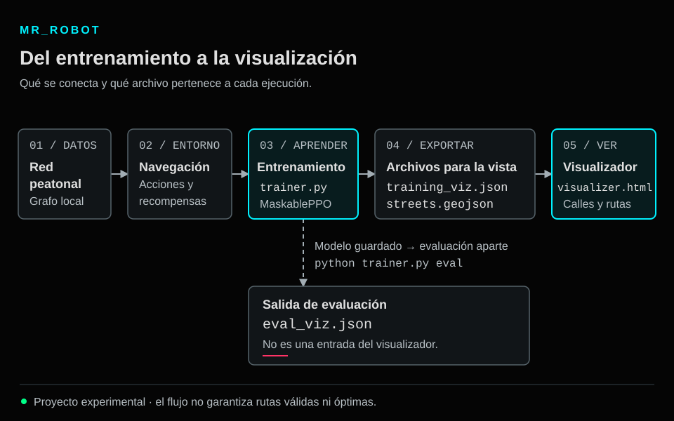

# 🤖 MR_ROBOT — Santiago Urban Navigator (Swarm Edition)

Pipeline de aprendizaje por refuerzo para explorar la navegación sobre la red peatonal de la Región Metropolitana de Santiago, Chile.


[Inicio rápido](#inicio-rápido) · [Entrenamiento](#entrenamiento-y-evaluación) · [Visualizador](#visualización) · [Arquitectura](#arquitectura)

> **Estado: prototipo experimental.** La navegación, las métricas de entrenamiento y la visualización son trabajo exploratorio; los resultados no están validados para uso operativo.

## Inicio rápido

Necesitas Python y acceso a la red para descargar el grafo cuando no existe una copia local y resolver direcciones. Se recomienda trabajar en un entorno virtual.

```bash
git clone https://github.com/geoidegeoidal/mr_robot.git
cd mr_robot
python -m pip install -r requirements.txt
```

**El repositorio no incluye un modelo entrenado ni los resultados necesarios para reproducir la animación.** Primero ejecuta el entrenamiento; después abre el visualizador.

## Entrenamiento y evaluación

```bash
# Entrenar con la ruta por defecto: Bellavista → Plaza de Maipú
python trainer.py

# Entrenar con una ruta personalizada por nombre
python trainer.py --start "Cerro Santa Lucia, Santiago" --end "Costanera Center, Providencia"

# Entrenar con coordenadas: latitud, longitud
python trainer.py --start "-33.4372, -70.6342" --end "-33.4025, -70.5802"

# Evaluar un modelo ya entrenado
python trainer.py eval
```

El entrenamiento configura 500.000 pasos y 15 entornos vectorizados. La descarga de la red y el entrenamiento pueden consumir tiempo y memoria; no se presupone una duración ni una tasa de éxito.

> **Límite actual de evaluación:** `eval` utiliza la ruta por defecto y no aplica `--start`/`--end`. Exporta `eval_viz.json`; el visualizador actual carga `training_viz.json`, no ese archivo de evaluación.

### Archivos generados

| Archivo | Uso |
|---|---|
| `santiago_master_walk.graphml` | Copia local de la red peatonal. |
| `models/mr_robot_ppo.zip` | Modelo guardado para evaluación. |
| `training_viz.json` | Trayectorias y métricas de entrenamiento. |
| `streets.geojson` | Calles para la capa de referencia visual. |
| `eval_viz.json` | Resultados de evaluación. |

Guarda una copia de los resultados que quieras conservar antes de repetir una ejecución: se utilizan rutas de salida fijas.

## Visualización

Con los resultados de entrenamiento en la raíz del proyecto:

```bash
python -m http.server 8080
```

Abre [http://localhost:8080/visualizer.html](http://localhost:8080/visualizer.html).

| Control | Función |
|---|---|
| ▶ PLAY | Reproducir o pausar la animación. |
| ◎ FOLLOW | Seguir al robot con la cámara. |
| ★ SUCCESS | Filtrar episodios que llegaron a la meta. |
| 🏆 TOP 3 | Mostrar los tres intentos con mayor recompensa acumulada. |

## Arquitectura



La red peatonal pasa al entorno de navegación y al entrenamiento. El visualizador carga
`training_viz.json` y `streets.geojson`; `python trainer.py eval` genera `eval_viz.json`
en una ejecución separada, no como entrada del visualizador.
[Fuente editable del diagrama](docs/readme/training-workflow.html).

| Componente | Responsabilidad |
|---|---|
| [data_handler.py](data_handler.py) | Descargar, cachear y proyectar el grafo; resolver nombres o coordenadas. |
| [environment.py](environment.py) | Entorno Gymnasium, acciones y recompensas de navegación. |
| [trainer.py](trainer.py) | Entrenar con MaskablePPO y exportar resultados. |
| [visualizer.html](visualizer.html) | Mostrar calles y trayectorias con D3.js. |

### Distancias y entornos compartidos

- **Distancia por calles:** Dijkstra calcula distancias hacia el objetivo sobre el grafo para orientar la recompensa. Esto no garantiza que la política aprenda una ruta válida u óptima.
- **Entrenamiento vectorizado:** `N_ENVS = 15` agrupa entornos mediante `DummyVecEnv`; no equivale a ejecutar quince procesos independientes.
- **Mapa compartido:** el entrenamiento precalcula el diccionario de distancias y lo entrega a cada entorno, evitando repetir ese cálculo. No se declara un porcentaje de mejora sin una medición reproducible.
- **Entrada flexible:** el origen y destino del entrenamiento aceptan texto o coordenadas geográficas.

## Configuración de entrenamiento

Los valores se definen al inicio de [trainer.py](trainer.py):

| Parámetro | Valor |
|---|---|
| Algoritmo | MaskablePPO (`sb3-contrib`) |
| Entornos | 15 |
| Pasos totales | 500.000 |
| Gamma | 0,995 |
| Coeficiente de entropía | 0,05 |
| Máximo por episodio | 12.000 pasos |

Son valores del prototipo, no hiperparámetros universalmente óptimos.

---

*Built with 🧠 and 🦾 by MR_ROBOT Pipeline*
